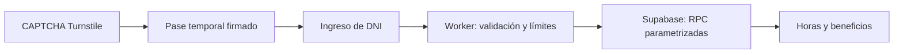

# HESM · Consulta de horas

[](https://github.com/gabyboan/consulta-horas/actions/workflows/security.yml)
[](https://hesm-horas.pages.dev/)
[](https://nodejs.org/)

Portal del personal para consultar horas, francos e imprevistos. Frontend estático en **Cloudflare Pages**, API en **Workers** y consultas parametrizadas a **Supabase**.

**[Abrir el portal](https://hesm-horas.pages.dev/) · [Desarrollo](docs/DEVELOPMENT.md) · [Despliegue](docs/DEPLOYMENT.md) · [Revisión de seguridad](SECURITY_REVIEW.md)**

## Cómo funciona



- El CAPTCHA se completa **antes** de pedir el DNI. El pase se comprueba en el servidor y vence a los 10 minutos.
- El DNI se envía mediante POST, en el cuerpo de la petición. Las respuestas personales llevan `Cache-Control: no-store`.
- Las cuentas de Recursos Humanos se usan en la gestión administrativa. Este portal solo permite consultar.

> [!IMPORTANT]
> La consulta es pública por decisión funcional: conocer un DNI y superar el CAPTCHA permite consultar sus datos. El CAPTCHA y los límites no acreditan la identidad del empleado. Este riesgo sigue abierto; ver [alcance y límites de seguridad](SECURITY_REVIEW.md).

## Empezar

Requiere **Node.js 22 o superior** y npm.

```sh
git clone https://github.com/gabyboan/consulta-horas.git
cd consulta-horas
npm ci
npm test
npm run check
```

Las pruebas utilizan datos ficticios y servicios externos simulados. No necesitan credenciales de producción. Para trabajar con el frontend y ejecutar las pruebas de navegador, seguir la [guía de desarrollo](docs/DEVELOPMENT.md).

## Estructura

```text
consulta-horas/
├── public/                 # Frontend de Pages y cabeceras HTTP
│   └── assets/             # Estilos, CAPTCHA y consulta
├── src/
│   ├── index.js            # Worker: acceso, sesión y consulta
│   └── security.js         # Entradas, límites e identidad opcional
├── test/                   # Pruebas de funcionalidad y seguridad
├── scripts/                # Navegador, límites y verificación publicada
├── docs/                   # Desarrollo y despliegue
├── .github/                # CI, despliegue manual y Dependabot
└── wrangler.jsonc          # Configuración del Worker
```

## Calidad y mantenimiento

GitHub Actions ejecuta pruebas, auditoría de dependencias, dry-run y navegador local en cada push a `main`, en pull requests y semanalmente. Las acciones están fijadas por SHA y las verificaciones no utilizan secretos de producción.

Dependabot propone actualizaciones semanales de npm y GitHub Actions. Los cambios requieren revisión; no hay merges automáticos.

El despliegue desde GitHub es **manual** y requiere un token de Cloudflare dedicado. Subir código ejecuta las verificaciones sin publicar producción. También se puede desplegar mediante `npx wrangler`; ambas opciones están en la [guía de despliegue](docs/DEPLOYMENT.md).

| Documento | Contenido |
| --- | --- |
| [Desarrollo](docs/DEVELOPMENT.md) | Instalación, pruebas y herramientas locales. |
| [Despliegue](docs/DEPLOYMENT.md) | Secretos, Cloudflare, límites y comprobación posterior. |
| [Revisión de seguridad](SECURITY_REVIEW.md) | Hallazgos confirmados, correcciones, evidencia y riesgos pendientes. |
| [Seguridad](SECURITY.md) | Tratamiento de reportes y cambios sensibles. |
| [Contribuir](CONTRIBUTING.md) | Cambios pequeños, verificaciones y manejo de datos. |
